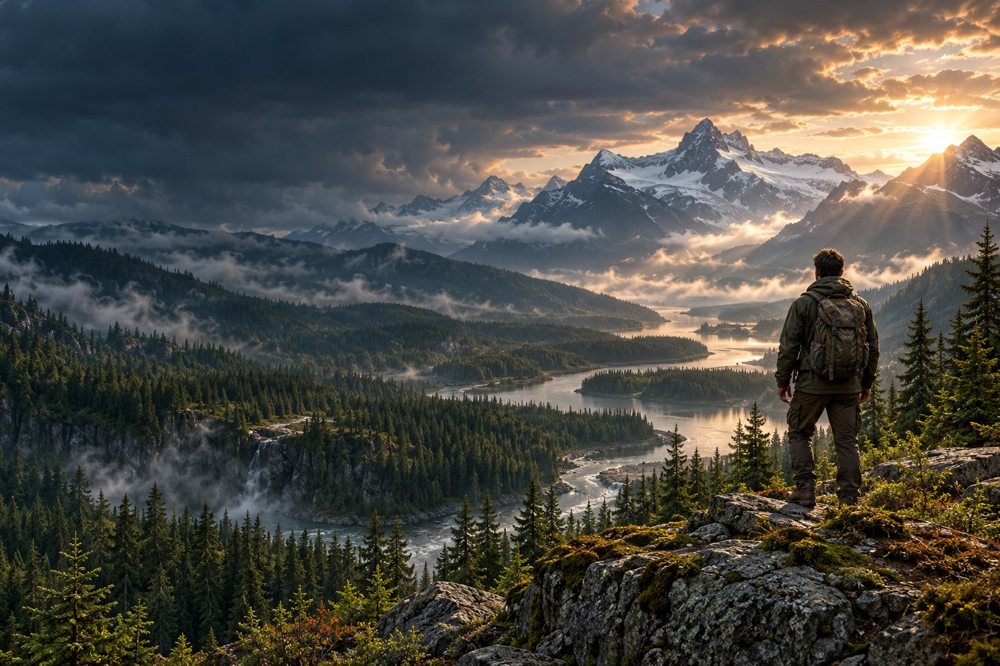
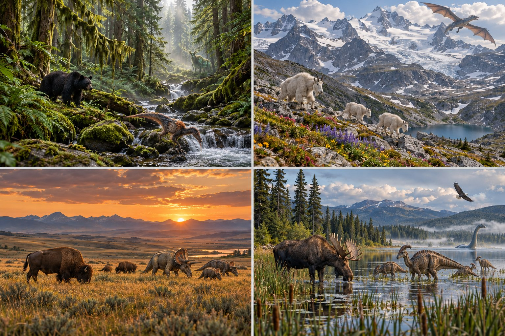
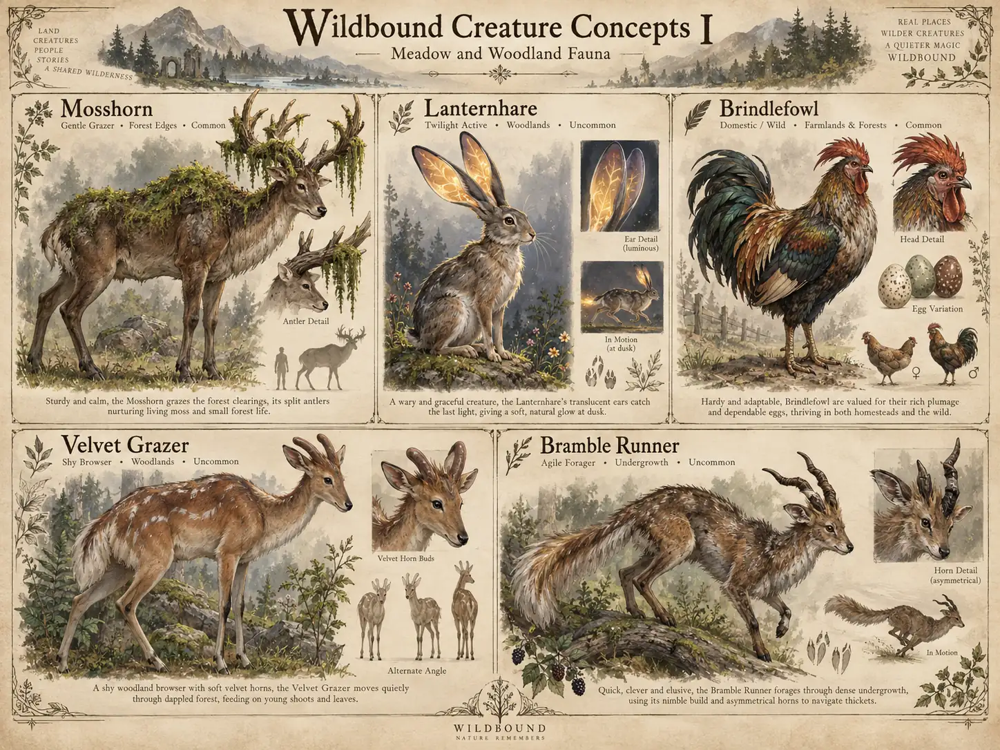
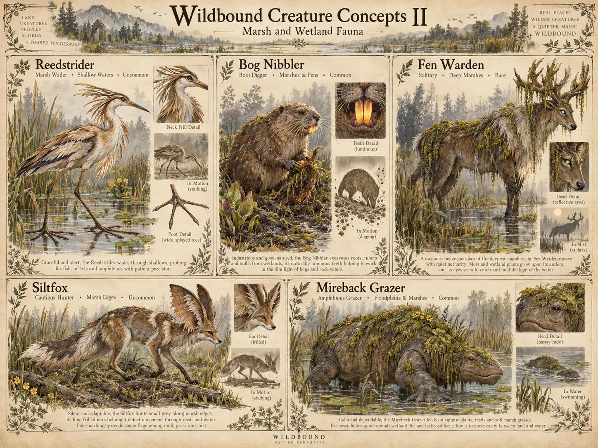
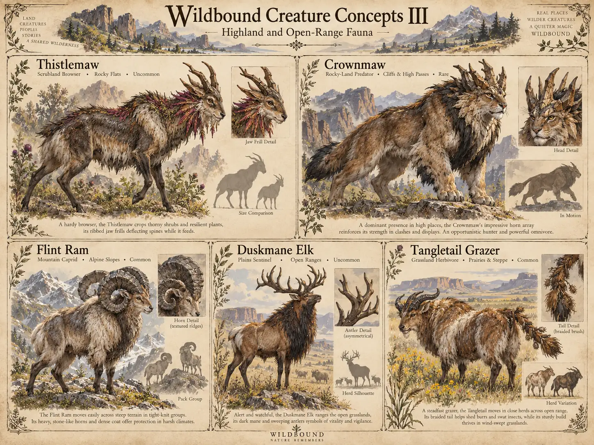
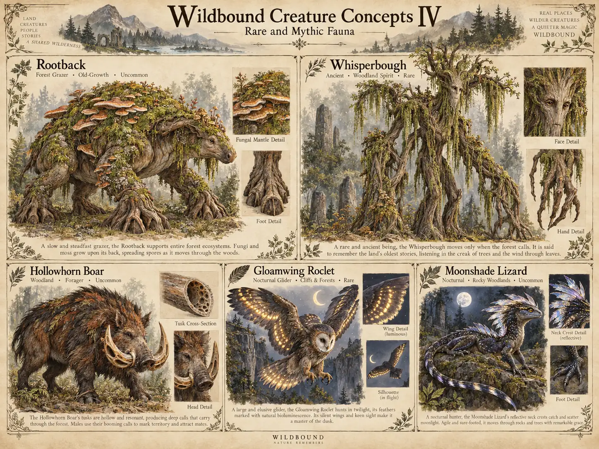
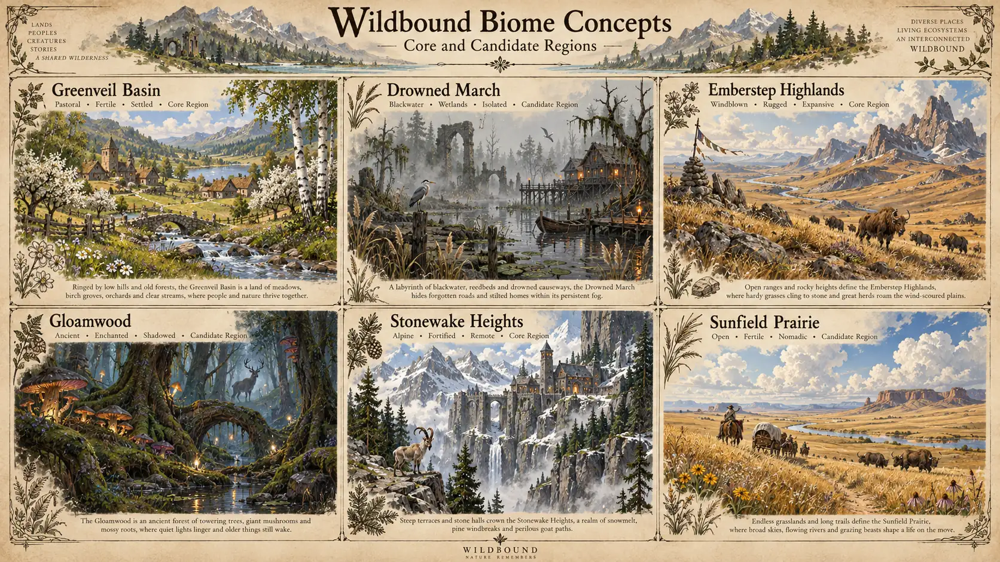
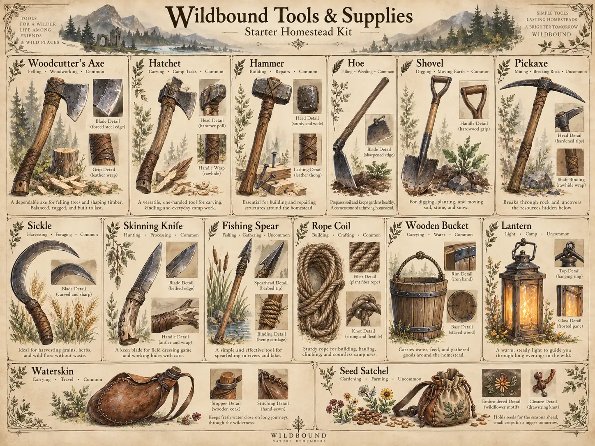
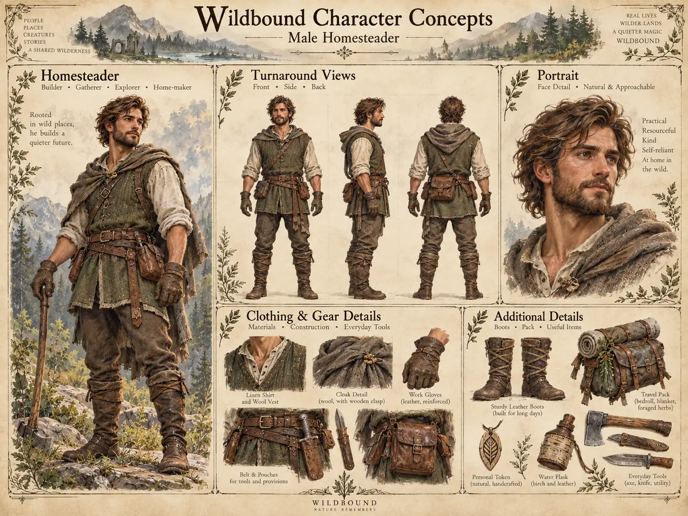
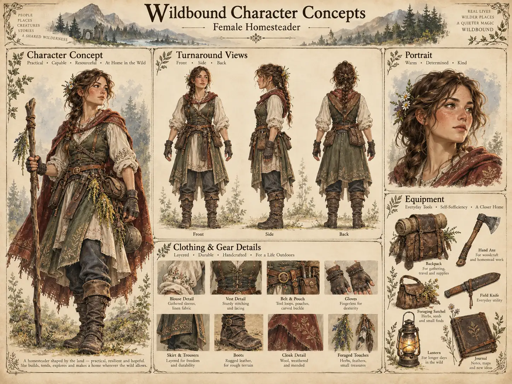

  

<h1 align="center">WILDBOUND</h1>

<strong>Build a home. Earn the wild's trust. Grow a life together.</strong>

A cooperative wilderness survival and homesteading game, built with Unreal Engine 5.

  <a href="docs/README.md">Explore the project</a> ·
  <a href="docs/world/biomes.md">Discover the world</a> ·
  <a href="docs/systems/animals.md">Meet the animals</a> ·
  <a href="ROADMAP.md">See the roadmap</a>

---

## A wilderness worth coming home to

Build a cottage beside a quiet stream. Raise animals that recognize and trust you. Explore old forests and marshes where ancient magic feels woven into the landscape.

Wildbound is about **creating a lasting life together** — finding a balance between the comfort of home and the mystery of a living wilderness.

| What makes Wildbound, Wildbound | |
| :-- | :-- |
| **🌿 Living wilderness** | Believable habitats, weather, wildlife, exploration and environmental magic. |
| **🐾 Animals that matter** | Observation, trust, taming, breeding, husbandry and meaningful relationships. |
| **🏡 A home you can shape** | Expressive voxel cottages, farms, barns, fences, bridges and settlements. |
| **🤝 A shared world** | Cooperative play, community stewardship and planned persistent dedicated servers. |

These are the game's **design pillars**, not a claim that every system is implemented.

## Step inside the world

**[Greenveil Basin](docs/world/biomes.md)** is warm and pastoral: orchards, homesteads, grazing animals and small, mysterious places beyond the treeline.

**[The Drowned March](docs/world/biomes.md)** is ancient and unsettling: blackwater, drowned causeways, pale reeds, fog and lights that invite more questions than answers.

The broader world includes candidate grasslands, mountain habitats, strange creatures and original peoples. Those ideas remain in design review rather than being promised playable content.

[Browse the art studio →](docs/art/README.md)

---

## The Wildbound Concept Atlas

*Twenty imagined creatures, six regional studies, everyday homestead equipment, and our first male and female character directions.* All images are **exploratory artwork**, not 3D models, playable content, or a finalized roster.

### The creatures · 20 original candidates

| **I · Meadow & Woodland** | **II · Marsh & Wetland** |
| :--: | :--: |
|  |  |

| **III · Highlands & Open Range** | **IV · Rare & Mythic** |
| :--: | :--: |
|  |  |

### The biomes · Six visual directions

*Greenveil, the Drowned March and Emberstep have existing world notes; Gloamwood, Stonewake Heights and Sunfield Prairie are **additional art-study names**, not approved production regions.*

### Tools for building a life

### The homesteaders · Male & Female

| **Male homesteader** | **Female homesteader** |
| :--: | :--: |
|  |  |

**[Open the complete concept-art gallery →](docs/art/concept-atlas/README.md)** · [What is currently playable?](docs/project/CURRENT-STATE.md)

---

## Where the project stands

**Early PC prototype · Unreal Engine 5.8.4 · Development in progress**

The October 22 Windows session compiled Wildbound and launched it in Epic's authored Electric Dreams forest environment with Wildbound's GameMode and HUD. The sample is installed locally and stays outside Git because its content is not redistributed by this project. The view uses native 1920×1080 and a 60 FPS cap, but traversal frame time has not been benchmarked. A bundled Quinn mannequin replaces the sphere as temporary rigged player art; its local asset setup is documented in [Current State](docs/project/CURRENT-STATE.md).

| Area | Actual status |
| :-- | :-- |
| **Unreal foundation** | Editor and game compiled; Windows test package launched. |
| **First Greenveil scene** | Epic's detailed authored Electric Dreams forest and river valley are the local visual base. The player uses a temporary rigged mannequin; the deer now wanders with a collision capsule. Check obstacle traversal and performance before carving out a small Greenveil slice. |
| **Animal needs** | Core C++ rules tested; care interactions still need in-game validation. |
| **Construction** | Temporary snapped blocks compiled; **not** voxel terrain and not yet playtested. |
| **Multiplayer** | Two clients joined a listen server; gameplay state synchronization **not yet verified**. |
| **Persistence, breeding & villages** | Not implemented. |

**The next milestone:** playtest the new player/deer collision around roots and logs, verify care and block placement, then create a small authored Greenveil slice before expanding the world.

[Current development state](docs/project/CURRENT-STATE.md) · [Next handoff](docs/project/SESSION-HANDOFF.md) · [Open milestones](ROADMAP.md)

## Find what you're looking for

| Explore | Build & follow development |
| :-- | :-- |
| [World and biome concepts](docs/world/biomes.md) | [Development roadmap](ROADMAP.md) |
| [Animals, trust and husbandry](docs/systems/animals.md) | [Current verified state](docs/project/CURRENT-STATE.md) |
| [Construction and homesteading](docs/systems/building.md) | [Developer setup](docs/developers/README.md) |
| [Cooperative world design](docs/systems/multiplayer.md) | [First playable tests](docs/developers/PROTOTYPE-PLAYTEST.md) |
| [Concept art gallery](docs/art/README.md) | [Project decisions](docs/project/DECISIONS.md) |

**[Open the full documentation library →](docs/README.md)** · [Systems guide](docs/systems/README.md) · [Development desk](docs/project/README.md)

### Creative workshop

New mythical creatures, fantastical villages, walking trees and giant mushroom forests are being explored in **draft** design proposals. They are not yet approved canon or implemented gameplay.

[Idea Board — draft PR #1](https://github.com/Systemkill90/WildBound/pull/1) · [Art studies and development checkpoint — draft PR #6](https://github.com/Systemkill90/WildBound/pull/6)

<strong>For developers: build notes and checks</strong>

The last recorded setup used Unreal Engine **5.8.4**, Visual Studio Community 2022 **[compiler version redacted]**, MSVC **[toolchain version redacted]**, and Windows SDK **[SDK version redacted]**. The packaged Windows executable is kept outside GitHub.

- [Get set up](docs/developers/README.md) and [follow the hands-on playtest](docs/developers/PROTOTYPE-PLAYTEST.md).
- From a compatible Windows checkout, `Tools/Start-Wildbound.cmd` attempts an editor build and Greenveil launch. Passing this script is not proof of playable features.
- Native simulation tests cover animal rules, prototype placement and snapshot serialization; those are **not** Unreal gameplay, dedicated-server or persistence tests.
- [Asset credits](docs/art/ASSET-CREDITS.md) identify third-party art and redistribution boundaries.
- [Documentation audit](docs/project/DOCUMENTATION-AUDIT-2026-10-21.md) records remaining evidence and configuration follow-ups.

---

<em>A lasting life together in a wilderness touched by quiet, ancient magic.</em>

<small>PC-first development · Xbox remains a future feasibility study · No release date announced</small>

**Rights and distribution:** Wildbound is an independent original project. The public repository has no project-wide open-source license selected. External Unreal/Epic assets carry their own license restrictions; public visibility does not grant reuse permission.
