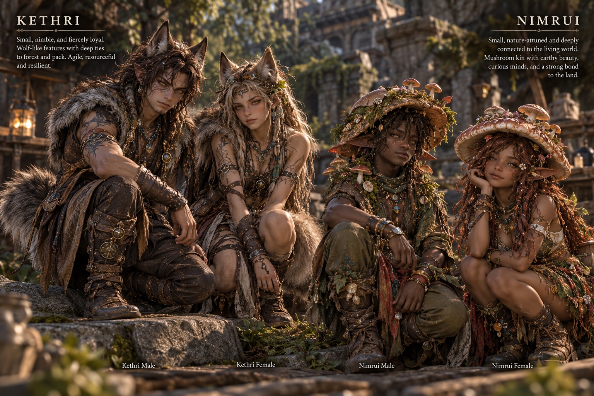
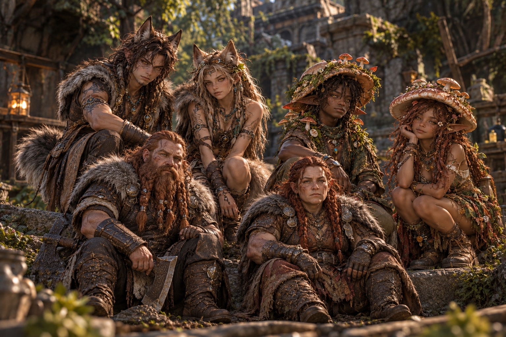
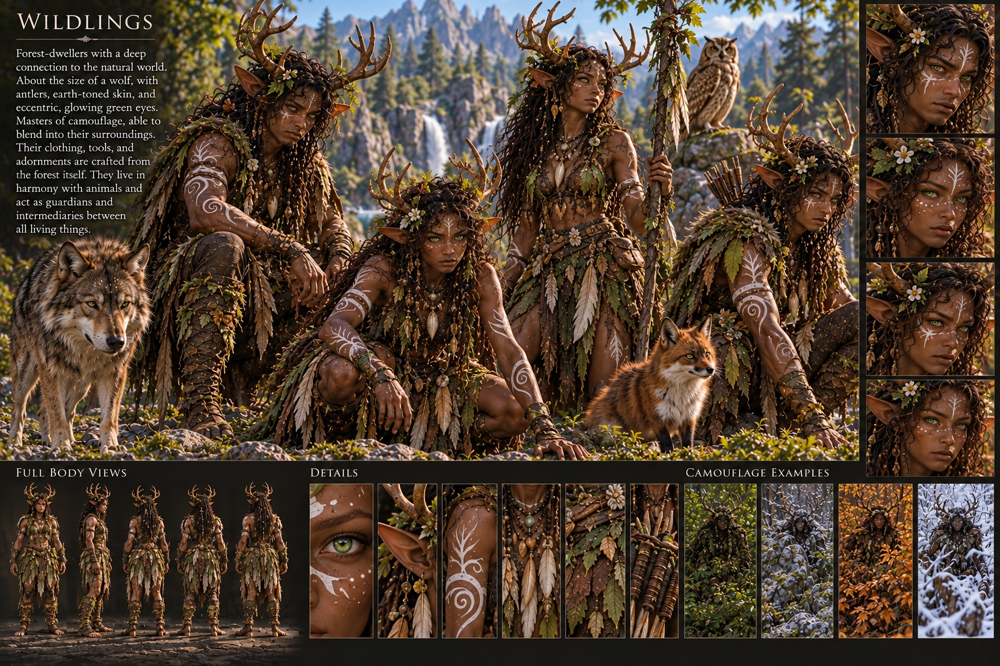
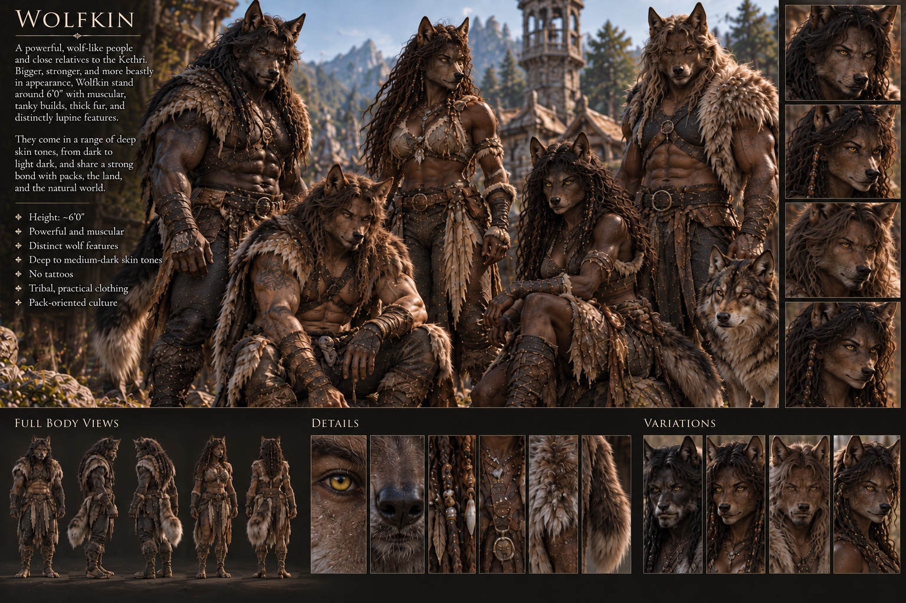
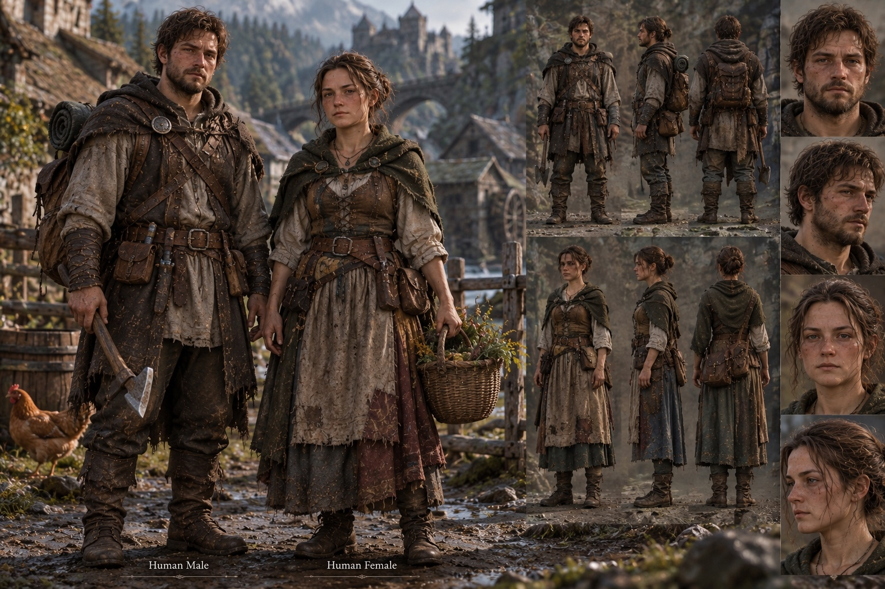
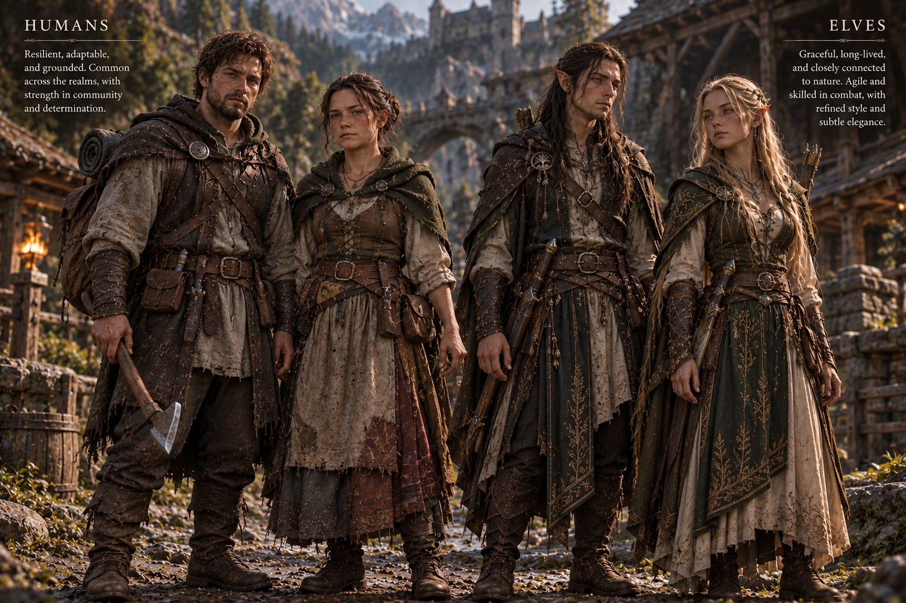
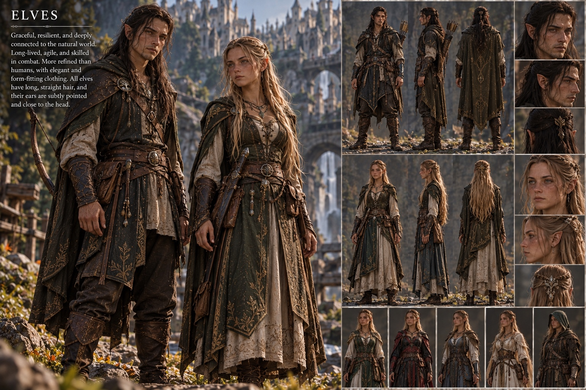
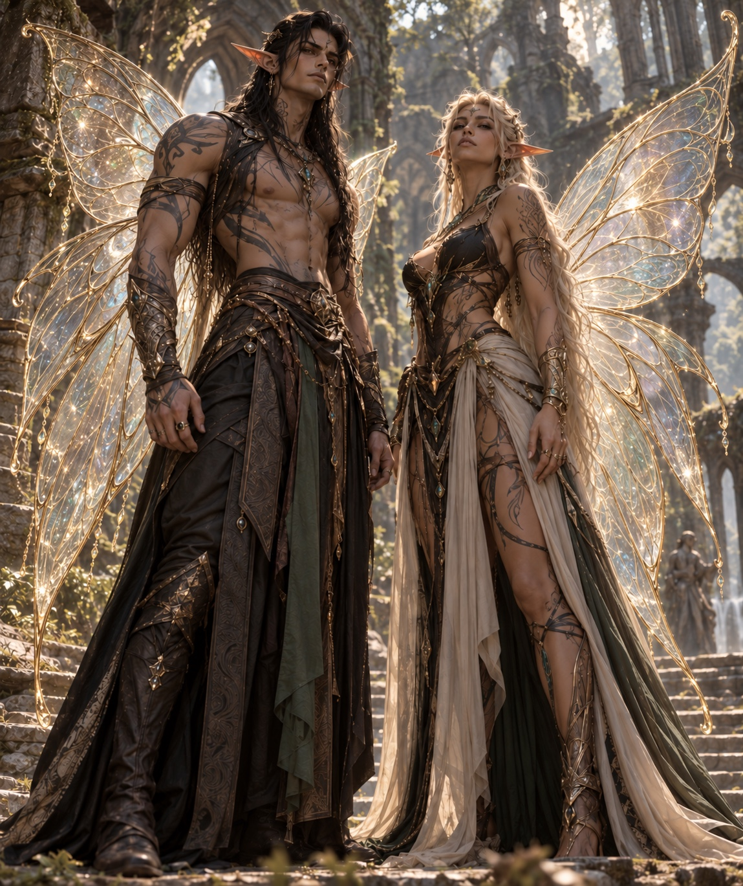
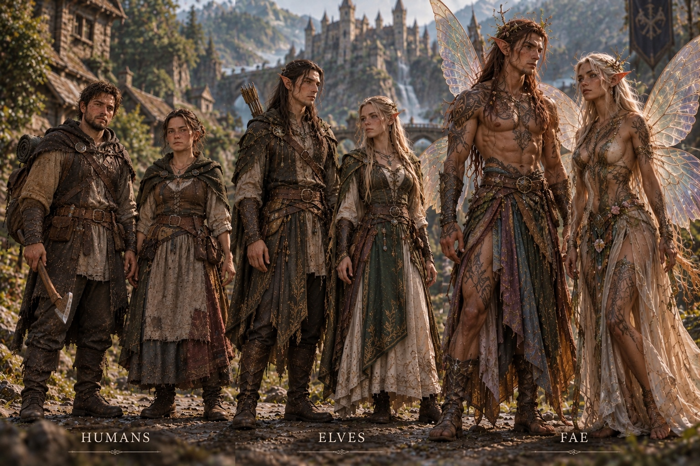

# Idea Board · character and culture studies

[← Illustrated concept atlas](../README.md) · [Art direction](../../README.md)

> Exploratory generated art saved from the Wildbound Idea Board on October 23, 2026. These images are references, not approved canon, production character designs, playable species, or in-game assets. Individual visual details may be inconsistent or malformed; use them to discuss shape, material, culture and mood rather than as literal model sheets.

The strongest recurring direction is a lived-in forest settlement: practical layered clothing, leather and woven details, timber and stone architecture, earthy colors, and nature motifs. The human and woodland-kin studies keep the character presentation grounded. The Fae studies push toward more visible magic; use those as a separate, more overt expression of the setting instead of applying glowing effects to every character or environment.

## Character and culture studies

### Woodland kin

### Settlers and elves

### Fae

## Use in development

- For Greenveil, prioritize convincing forest ecology, readable trails and water, useful small-scale settlement details, and believable foliage. These character sheets do not define a new biome palette or require settlement NPCs in the current exploration slice.
- Keep magic tied to ecology and story. Use subtle traces in the ordinary woodland; reserve obvious wings, strong glow and ornate presentation for explicit Fae concepts or later scenes.
- Do not create or extend animal gameplay from these images. Creature and character mechanics remain separate priorities.
- When a concept advances, make a new, reviewable design decision and produce proper production references for anatomy, silhouette, materials, rigging and animation.

All artwork on this page was supplied in the Wildbound Idea Board and saved here for project reference. The images do not grant rights to any third-party model, costume, or other depicted source material.
