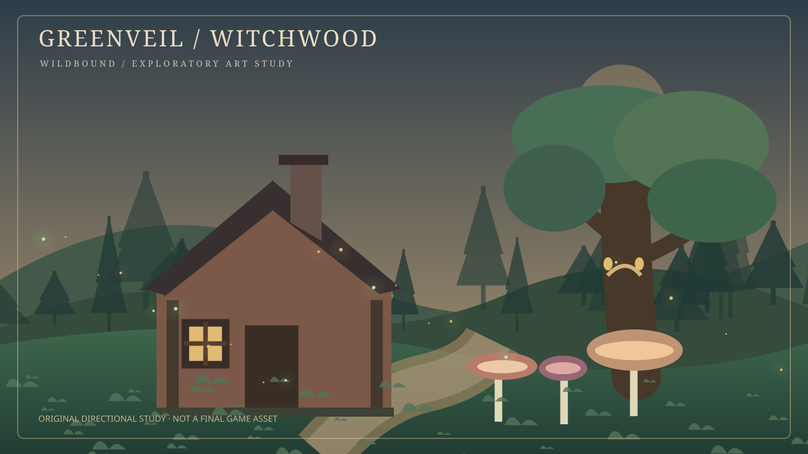
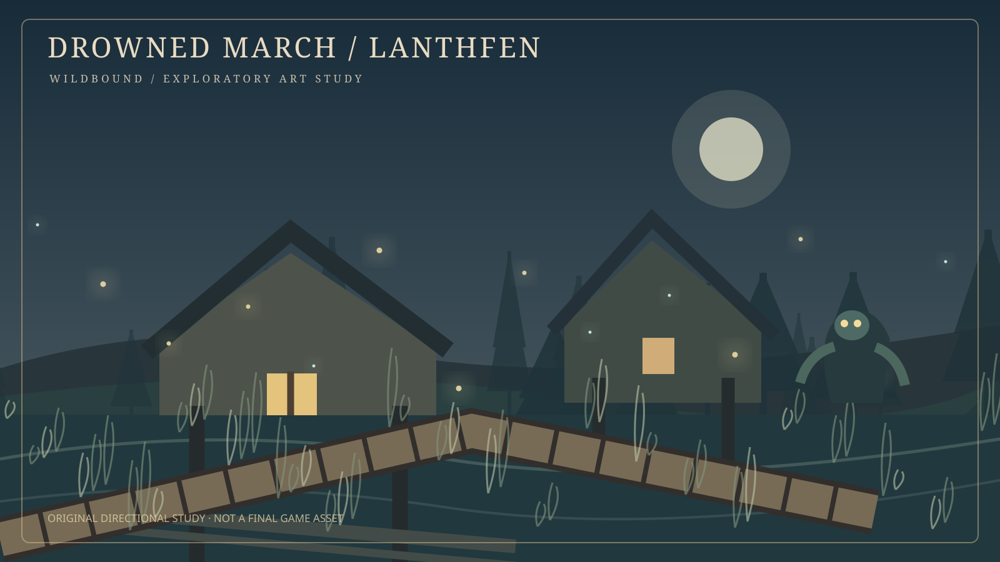
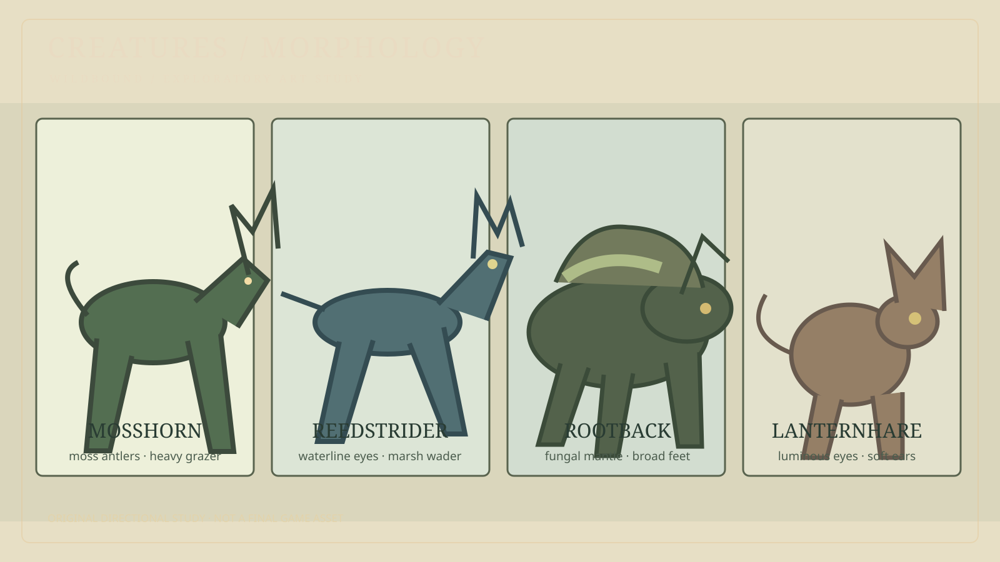
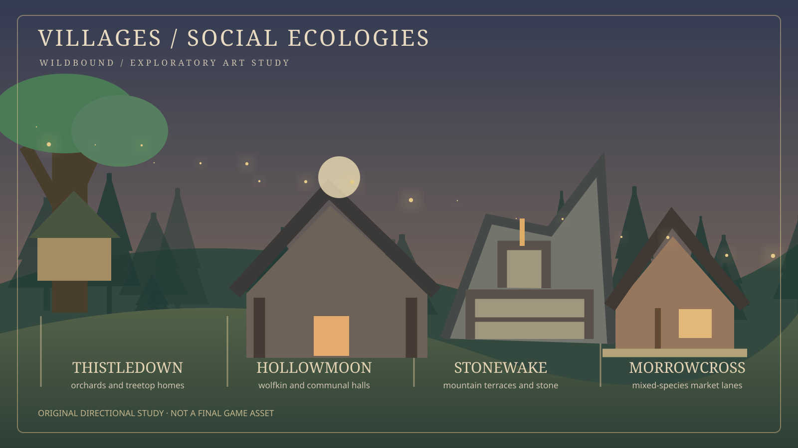

# Wildbound concept-art gallery — exploratory studies

[World and biomes](../../world/biomes.md) · [Creature candidates](../../world/creature-candidates.md) · [Development checkpoint](../../project/TRUCK-STOP-2026-10-21.md)

> **Status: mood exploration only.** These are four newly authored, original vector illustrations made to test silhouette, habitat, architecture, and color. They are **not** imported Unreal assets, actual in-game screenshots, commissioned finished designs, approved canon, or promises of upcoming features. No reference-world creatures, characters, or buildings are copied.

## Greenveil Witchwood — cozy with a strange edge

[Open full vector study](greenveil-witchwood.svg)

**Art direction:** timber cottage, warm window, soft path, old-root canopy, enormous mushrooms, slight signs of a rare aware tree. The fantastical accents should be biologically plausible, local and subdued. Save overly saturated effects for scarce discoveries. This is a *possible pocket of Greenveil*, not the appearance of the whole biome.

## Lanthfen — a night in the Drowned March

[Open full vector study](drowned-march-lanthfen.svg)

**Art direction:** dark water and layered fog do most of the frightening work. Stilt homes, raised paths, pale reeds, moonlit rooflines and isolated lights. A small amphibious silhouette hints at original Veshari people without assuming they are implemented. Avoid literal borrowed marsh architecture or plot elements.

## Creature morphology — four proposed animal lineages

[Open full vector study](fantasy-creature-silhouettes.svg)

**Art direction:** natural weight, credible locomotion, recognizable dietary niches. Horn, eye, fur, limb and fungal variations should each express habitat and behavior, rather than random fantasy additions. Shapes are schematic, not anatomical or rig-ready.

## Village material language — four proposed settlements

[Open full vector study](fantasy-village-silhouettes.svg)

**Art direction:** show how local material and ecology produce distinct architecture. The four pictured places are candidate names. This sheet does not imply village NPC simulation exists. Lanthfen, Sporeveil and Starhush also remain in the broader concept document.

## Production use and next review

- Keep original full-resolution/vector source studies in this folder. Future raster exports may be created, but originals are retained.
- Translate at most **one** candidate creature into a conventional anatomy sheet with side/front/back views, skeletal explanation, estimated rig complexity and known locomotion before creating a 3D asset.
- Translate at most **one** cottage and one barn module into measured, grid-compatible prototypes before expanding village kit variety.
- Test marsh palettes in a very small lighting study; do not produce another full biome before the Greenveil interaction loop works.
- No concept here is a licensing permission to reuse somebody else's game, creature or environment art. Names and visual originality still need release-stage review.
