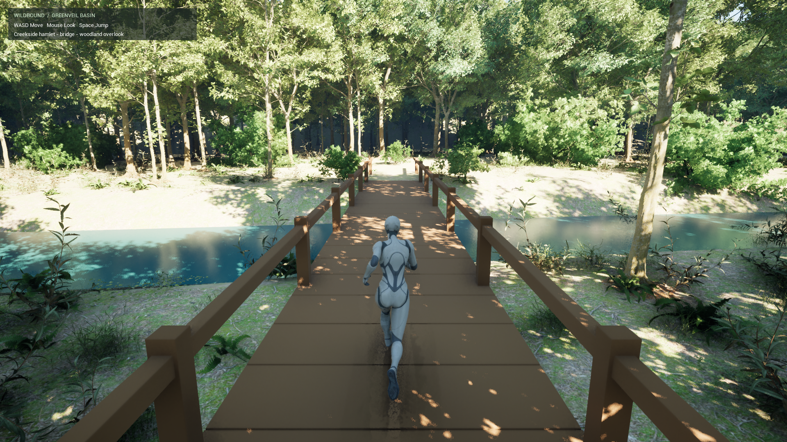

# Greenveil exploration desktop test — October 22, 2026

## Build and scope

The owner's corrected priority is a populated exploration map before animal gameplay. Work began from current GitHub `main` / `6ca9fc9` in the documented desktop project, isolated on `staging/greenveil-exploration-2026-10-22`. Animal-intent PR #9 remained an open, unmerged draft; its commits were not used.

New map: `/Game/Maps/GreenveilExploration`, 180 × 160 m. Three cottage placeholders, two bridges, gardens/fences, workbenches/tool silhouettes, an overlook, creek, terrain and trails sit among instanced vegetation. [Exact counts](evidence/greenveil-generation-2026-10-22.json) and [asset provenance](../art/GREENVEIL-ASSET-INVENTORY.md) are recorded separately.

Engine 5.8.4. Editor and Win64 Development game targets compiled. Corrected UAT cook/stage/archive succeeded. The Windows package is kept in a local build archive outside the repository.

## Packaged tests

Both runs used the R2 packaged executable, native 1920×1080, screen percentage 100%, dynamic resolution off, VSync off and no FPS cap. Hardware ray tracing is disabled. No build/diagnostic commandlet ran concurrently. High was the first packaged run; Medium followed it, so process/shader caches differ. Hardware identifiers are intentionally omitted from this public report.

The probe feeds the real Character Movement input path, turns the player-controller camera toward each leg and captures rendered screenshots. It does not teleport the pawn. After its initial warm-up window it samples wall-clock intervals between ticks; screenshot overhead and remaining hitches are included. These are complete-frame timings, not isolated GPU times or an exhaustive hardware benchmark.

| Result | High, all groups 2 | Medium, all groups 1 |
| :-- | --: | --: |
| Waypoints | PASS, 15/15 | PASS, 15/15 |
| Travel | 326.1 m | 326.0 m |
| Complete navigation paths | 14/14 | 14/14 |
| Animal actors | 0 | 0 |
| Frame samples | 2,311 | 2,877 |
| Mean frame | 23.968 ms | 19.157 ms |
| Mean FPS | 41.72 | 52.20 |
| p95 frame | 26.480 ms | 22.041 ms |
| p99 frame | 29.668 ms | 24.112 ms |
| Process physical memory at end | 1,528.6 MiB | 1,418.8 MiB |
| Process peak physical memory | 4,408.7 MiB | 1,721.1 MiB |

Both runs entered/exited the first cottage, crossed both bridges and completed the woodland return. All recorded waypoints were grounded; all path queries were valid and non-partial. Machine-written [High](evidence/greenveil-high-2026-10-22.txt) and [Medium](evidence/greenveil-medium-2026-10-22.txt) summaries are tracked. Local raw logs, sorted frame CSV and rendered captures remain in the archive's `Evidence` directories and project `Saved/GreenveilBuild`.

This demonstrates bounded traversal, navigation and memory use. **Neither profile sustained 60 FPS on this machine.** Medium is the normal launcher default, with a 60 FPS ceiling. Further optimization is needed for a native-1080p locked-60 target; no minimum hardware spec is inferred.

## Defects corrected during actual testing

- Named Python rotation arguments fixed tilted foliage. OBJ axis/winding correction restored the terrain; bounds, rendering and collision traversal were checked afterward.
- A bare spawned nav volume had zero extent. The editor volume factory now creates its real brush; asset compilation finishes before the nav build. Generated bounds span X ±9,000, Y ±8,000, Z −1,500 to 2,500 cm. Editor projection and packaged pathfinding pass.
- Four CC0 materials now save instanced-static-mesh usage flags, preventing default-material fallbacks.
- The first return segment collided with a cottage. The tested route returns west of the hamlet and passes.
- The first cook failed with eight Landmass/editor-texture exclusion errors. Omitting `SkipCookingEditorContent` fixed the cook; no missing-content error was suppressed.

## Protection and limits

The prior `WildBoundPreAlpha5` package was not overwritten. The pre-existing local GreenveilField map edit remains preserved and excluded from this commit. R2 uses a separate local archive. Source-restricted Epic/Fab art stays local; new original map/assets use LFS. See the inventory for rights evidence and boundaries.

Static wiring passed 61 checks and both Python files parsed. Documentation validation passed 189 internal links before the rendered-capture link was added. These checks do not substitute for packaged gameplay. The protected package's before/after file inventory matched in paths, sizes and modification times.

This is a local pre-alpha exploration demo. Architecture, tools, creek water and Quinn remain placeholders; interiors are sparse. There is no new fluid/swimming, dynamic weather/day-night, gathering, farming, NPC, animal, multiplayer or persistence system. Daylight and fog provide atmosphere. Terrain is a static heightfield mesh. One automated loop does not exhaustively test physical keyboard/mouse bindings, jumping, every off-trail obstacle, camera obstruction or long-run stability. Those remain manual QA work.

[Current state](CURRENT-STATE.md) · [Handoff](SESSION-HANDOFF.md) · [Roadmap](../../ROADMAP.md)

## V5 creek material and bridge pass — October 22

The later V5 package was built with UE 5.8.4 from a workstation-local checkout. Editor/game compilation succeeded, map regeneration reported zero errors, and UAT cook/stage/archive succeeded. The local Windows archive is outside the repository; V4 was preserved. A new original PBR material references the locally installed Megascans swamp-water normal, and both bridge decks were shortened to 14 m. The source texture remains local and is not added to the repository.

Two actual packaged, uncapped Medium traversals at native 1920×1080 used real Character Movement input and reached all 15 grounded route points over approximately 326 m. Both recorded 14/14 valid navigation legs, zero navigation failures and zero animal actors. The first pass contained shader/PSO cache misses; the second repeated traversal warmed those caches.

| V5 result | Cold run | Cache-warmed repeat |
| :-- | --: | --: |
| Waypoints / travel | 15/15 / 325.9 m | 15/15 / 326.0 m |
| Frames | 2,178 | 2,748 |
| Mean frame / FPS | 25.391 ms / 39.38 | 20.043 ms / 49.89 |
| p95 / p99 frame | 44.751 / 66.686 ms | 22.764 / 24.609 ms |
| Process peak physical memory | 1,592.1 MiB | 1,545.8 MiB |
| Resolution / settings | 1920×1080, Medium, uncapped | 1920×1080, Medium, uncapped |

The actual V5 captures show that the creek remains nearly black and several clearing patches are over-bright. The material compiles and cooks, but its appearance is **not fixed**. The 49.89 FPS warmed average remains below the 60 FPS target. Screenshots, frame data, summaries and raw runtime logs are retained only in ignored local build folders; the packaged summary file is overwritten by later test runs, so preserve those logs when comparing runs. This report intentionally excludes machine identifiers and local filesystem paths.

[Daily development notes](DAILY-DEVELOPMENT.md) · [Current state](CURRENT-STATE.md) · [Handoff](SESSION-HANDOFF.md)

## Relocated-NVMe package verification

After storage was relocated, the editor and Win64 package were rebuilt using UE 5.8.4. The package remained in a local build archive and the packaged game was launched for verification.

The uncapped, native-1920×1080 Medium automated cold-start traversal passed **15/15 grounded waypoints**, travelled **326.0 m**, and recorded **zero navigation failures and zero animal actors**. Across 2,700 frames it averaged **49.03 FPS** (20.398 ms), with **23.046 ms p95 / 24.917 ms p99**. End-of-run physical memory was **1,679.1 MiB**, peak was **3,991.0 MiB**. The log recorded many shader/PSO cache misses during startup, so this is a cold-start measurement, not a settled-play estimate or a 60 FPS claim. See [the latest packaged capture](../art/greenveil-exploration-verified-2026-10-22.png) and `GreenveilTraversal-summary.txt` in the packaged game's Saved directory.

Project, engine, asset, cache and local-model storage locations are workstation-specific and intentionally omitted from this public handoff.

Visual review of the new route capture confirms the authored vegetation/creek environment renders in the packaged build. It also shows an over-bright clearing and the current mannequin/cottage placeholders; those remain visible polish work. The automated route verifies movement and grounding, not hand-operated feeding, watering, construction, multiplayer, or animal behavior.
