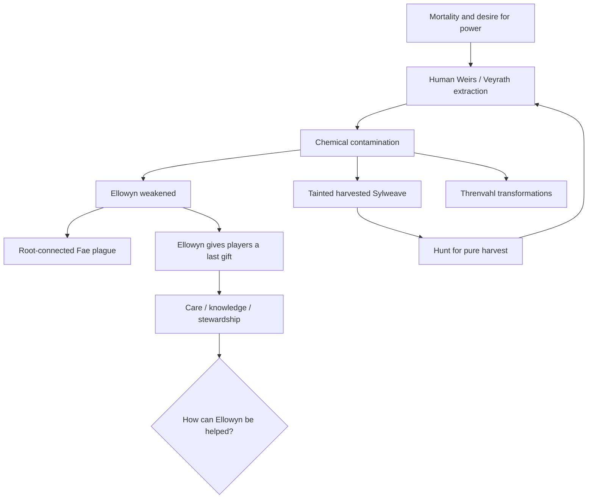

# 01 | Ellowyn, the Sylweave and a wounded world
**Canon premises distinguished from suggested elaborations.**

## Approved foundations
The Sylweave flows through Ellowyn and sustains **all life** without assigning good or evil. Humans originated the Weirs and Veyrath. They pursued longevity, immortality and power with extraction machinery and a chemical process. That chemical poisons Ellowyn, contaminates harvested Sylweave and transforms exposed beings into **the Threnvahl**. Rather than stopping, the extractors continue seeking an untainted batch, further poisoning the source. Ellowyn uses her remaining strength to empower players, whose path to helping her requires living on the land and learning its creatures and peoples.

## Proposed historical sequence — not settled dates
1. **Age of Roots:** Fae clans thrive across connected wooded and river valleys. Diverse peoples build distinct settlements within shared ecological systems.
2. **Age of Hunger:** A subset of mortal humans researches Sylweave extraction to escape age and disease; early Weirs and Veyrath emerge.
3. **The First Siphon:** Machines, conduits and chemical stabilizers rupture otherwise living root interfaces. Some first harvests look promising.
4. **The Spoiled Harvest:** Contamination spreads through root routes; failures incentivize longer/deeper siphoning.
5. **The Withering:** Fae-specific plague expands through their root communion; villages become empty; the survivors migrate and pool clan knowledge.
6. **The Last Gift:** Ellowyn reaches outward to players. These adventurers must learn ecology, cooperation, and the cost of intervention.

No historical dates, number of extraction sites, culpable leader, or ending are approved.

## Causality diagram

## Proposed environmental clues grid
| Site | Visual and audio cues | Discoverable history | Future interaction (unapproved) |
|---|---|---|---|
| Ancient root shrine | Polished bark, threadlike pale light, absent bird calls | Root communion once routine | Inspect seasonal inscriptions |
| Abandoned Fae orchard | Fruit still grows; doors left open; abandoned woven baskets | Flight was sudden | Read drawings rather than diary walls |
| Extraction scar | Oxidized metal, fused roots, mineral staining | Industrial methods were repeated | Collect contamination samples |
| Quarantined road | Covered water wells, warning markers, empty waystations | Fae attempted containment | Decode clan symbols |
| Threnvahl hollow | Hard deposits, altered tracks, biological asymmetry | Contamination affects flesh | Avoid or study different stages |
| Remote refuge | Varied clan structures, controlled water, guarded root access | Survival depends on collaboration | Earn access through trust |

## Disease logic — candidate constraints requiring approval
- The plague is **Fae-specific** and tied to their biology/connection with the network; it does not automatically infect other species.
- Exposure could involve root contact, tainted water, or both. Do not treat any route as established.
- Rapid wound healing must not grant immunity to internal contamination; otherwise the central tragedy collapses.
- An environmental remedy is preferable to an instantly purchasable cure, but the resolution is not approved.
- Avoid portraying the Fae as universally helpless: distinct clans should have meaningful survival strategies.

## Story design safeguard
The Veyrath represent a specific human faction, **not all humans**. Neither Sylweave nor Ellowyn should morally discriminate among creatures. The Threnvahl deserve ecological and emotional context, not just disposable enemies.

## First minimal story experiment
A 10-minute noncombat prototype: discover a ruined root shrine; observe one healthy and one poisoned root; hear a short, optional echo of past life; leave with a journal entry. No combat faction, cinematic, magical ability, or quest chain required yet.
