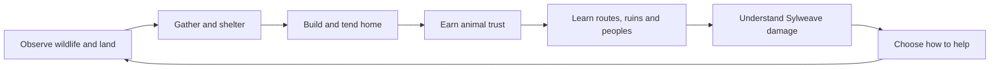

# 06 | The player journey and buildable scope

## The gameplay promise
Players build a home **while discovering why the wilderness is changing**. Work, companionship and ecological care remain valuable even when the central story is ignored. The main plot should *emerge from* activity, not replace it.

## Player loop / progression

## Proposed gameplay interfaces
| Activity | Early-game experience | Late-game expansion (not committed) | Co-op consideration |
|---|---|---|---|
| Build | One-meter placement proof evolves into expressive voxel material shaping | Bridges, barns, settlement neighborhoods | Shared permissions and grief prevention |
| Animal care | Read needs and stress, feed/water by hand | Herd, breed, manage lineage and ecology | Server-owned values, offline-care ceilings |
| Farming | Plant/water/harvest familiar crops | Orchards, soil health, seasonal specialization | Long-running world state |
| Discovery | Inspect tracks, roots and village remains | Cross-cultural archives and restoration quests | Per-player discovery vs shared world changes |
| Crafting | Basic tools and repairs | Building materials, husbandry equipment | Inventory authorization and shared storage |
| Survival | Balanced exposure, food/water and shelter | Climate-specific hazards | Non-punitive offline rules |
| Magic | Observe living-network disturbances | Syltouch-inspired interactions or Ellowyn gifts | Powers unspecified; keep authority server-side |
| Settlement trust | Help one NPC with a grounded request | Interlinked economies and cultural relationships | Track world and per-player trust separately |

## Three quest prototypes — proposals
**Root Without Voice:** inspect a silent root shrine, compare signs of disease, add a journal sketch. No power unlock required.

**A Quiet Barn:** wild deer hesitates near a pen; find safe water and a shelter spot, observe stress rather than forcing taming.

**The Empty Ferry:** reconstruct a route from bells and flood markers; learn an abandoned Vaelora village's history.

## A small playable vertical slice
One 60m-ish Greenveil forest clearing, a moveable third-person character, one animated deer, one feeding/watering loop, temporary build/tear-down of a small enclosure, simple journal clue, and two-player authoritative sync. This is a **target**, not a declaration of completion.

## Multiplayer and persistence gates
Server authoritative care, item consumption, construction permissions, animal positions and trust; versioned saves; backup recovery; deterministic denial for invalid interaction; population and offline-tick policies. Validate first with two actual clients sending care/build commands, not connection success alone.

## Out of initial scope
Full Fae city simulation, underwater village network, sentient-tree AI, dozens of rigged creatures, complete disease epidemiology, continent-scale generation, sophisticated NPC schedules, console submission.

## Story-content production rule
Every large narrative feature gets a low-cost environmental clue test before a full NPC/quest implementation. Preserve ambiguity, player choice, and the homestead identity.
